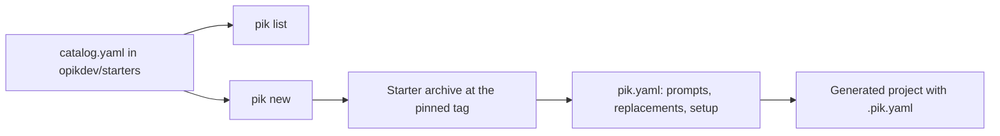

# Architecture

| Package | Path | Does |
|---|---|---|
| Entry point | `cmd/pik/` | Sets the version and runs the CLI |
| Commands | `internal/cli/` | `new`, `list`, and `doctor`, with prompts and `--json` output |
| Catalog | `internal/catalog/` | Parses `catalog.yaml` and finds a released starter |
| Manifest | `internal/manifest/` | Parses and validates each starter's `pik.yaml` |
| Project | `internal/project/` | Downloads, extracts, customizes, and records a project |
| Archive | `internal/archive/` | Extracts a tarball safely, with size and path limits |
| Source | `internal/source/` | Fetches the catalog, manifests, and archives, with test overrides |
| Tools | `internal/tools/` | Checks that required tools are installed, for `pik doctor` |

## Key behaviors

- **The catalog stays in opikdev/starters.** pik reads it from `main` there, so a new starter shows up without a pik release.
- **Projects come from tags.** `pik new` downloads the archive of the tag the catalog pins, never a branch.
- **Compatibility is tested both ways.** This repo's CI generates every released starter with the pik it just built, and the starters repo's CI does the same with the latest pik release.
- **Old pik keeps working.** pik ignores catalog keys and entry types it doesn't know, so new ones never break an installed release. v0.1 rejects unknown entry types, so add new types only once v0.1 is rare.
- **Every channel verifies.** `install.sh` and `create-pik` check the release checksum, and `install.sh` also checks the cosign signature when cosign is installed.
